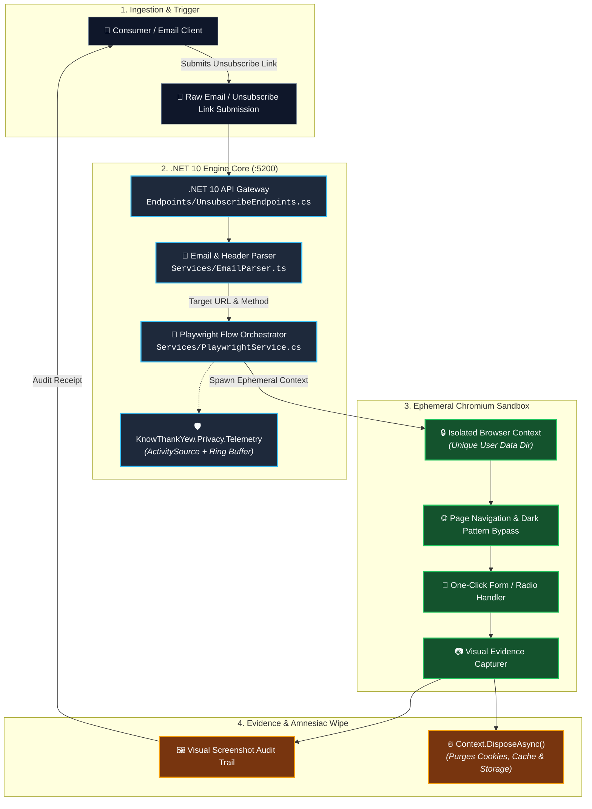
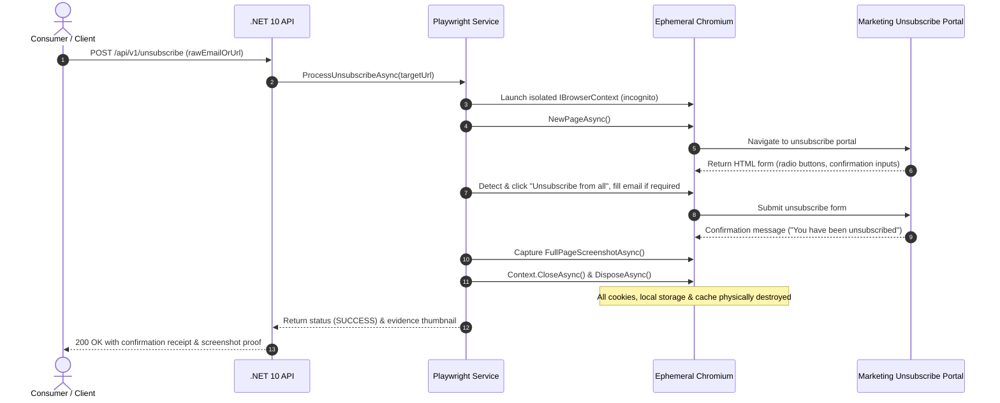

<!-- diagram-meta
  last-validated: 2026-10-19
  covers: [MailStripper/**, MailStripper.Tests/**]
  generated-by: manual
-->

# Architecture & Invariants Specification: MailStripper Unsubscribe Engine

> Headless Playwright automation agent, CAN-SPAM Act verifier, and predatory dark-pattern email unsubscriber.

---

## 1. Executive Summary

`mailStripper` is a specialized automation reality engine in the `knowthankyew` portfolio built to dismantle dark patterns in commercial marketing emails. Using .NET 10 and Playwright headless Chromium, it navigates labyrinthine unsubscribe flows, completes multi-step confirmation sequences, validates adherence to federal CAN-SPAM rules (15 U.S.C. § 7704) and FTC Click-to-Cancel standards, captures cryptographic screenshot evidence of completion, and terminates with zero residual cookie or credential storage.

---

## 2. System Architecture & Component Interactions

### A. Execution Sandbox & Isolation Architecture



### B. Automated Unsubscribe & Verification Lifecycle



---

## 3. Core Architectural Invariants

| # | Invariant | Enforcement & Guarantee |
|:--|:----------|:------------------------|
| 1 | **Ephemeral Sandboxing** | Every unsubscribe operation executes inside an isolated, newly instantiated browser context destroyed immediately upon completion. |
| 2 | **Zero Credential Persistence** | User email addresses and session cookies are kept exclusively in transient heap variables; never stored in a database or logs. |
| 3 | **Central Package Management (CPM)** | 100% of .NET packages pinned centrally in `Directory.Packages.props` with fail-closed security gating (`NU1903`/`NU1904`). |
| 4 | **Visual Evidence Verification** | An unforgeable visual snapshot of the confirmation page is generated before context disposal, providing legal proof of cancellation under CAN-SPAM. |
| 5 | **Volatile Operational Telemetry** | Telemetry is strictly allowlisted via `KnowThankYew.Privacy.Telemetry`; domain names, recipient emails, and URLs are sanitized. |

---

## 4. Directory Structure

```
mailStripper/
├── Directory.Build.props        # NuGetAudit & security warnings
├── Directory.Packages.props     # Central Package Management (CPM)
├── Dockerfile                   # Multi-stage container with Playwright dependencies
├── mailStripper.slnx            # Solution definition
├── MailStripper/
│   ├── Endpoints/               # .NET 10 Minimal API endpoints
│   ├── Models/                  # Request/response DTOs & status types
│   ├── Security/                # URL sanitization & host allowlisting
│   ├── Services/                # Playwright headless engine & email parsing
│   ├── Program.cs               # Application entrypoint & DI setup
│   └── wwwroot/                 # Web interface assets
├── MailStripper.Tests/          # xUnit test suite with mocked browser flows
└── docs/
    ├── ARCHITECTURE.md          # Architecture, data flow & invariant specification
    └── PRIVACY_TELEMETRY_SCHEMA.md # Telemetry contract specification
```
