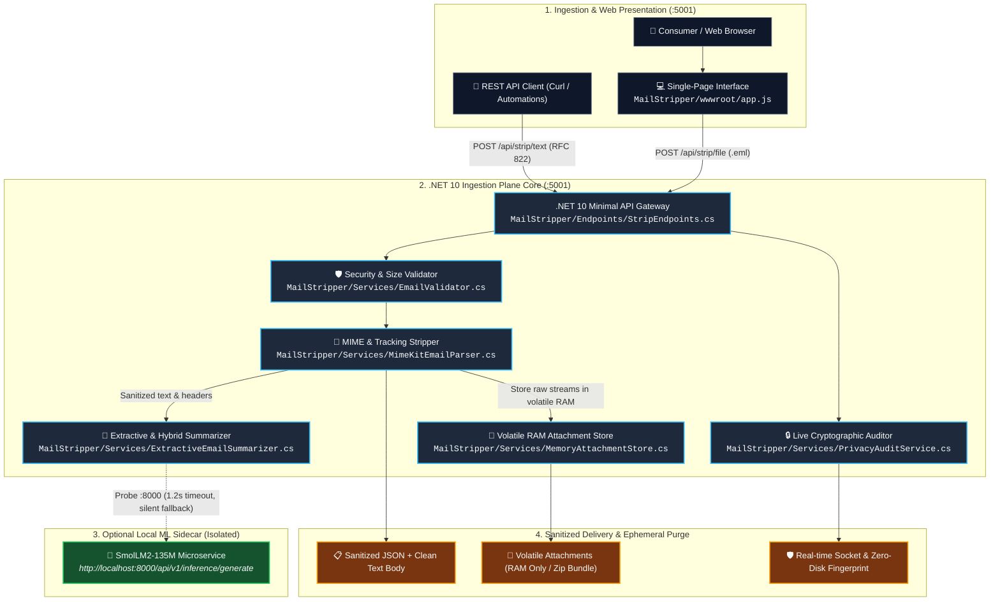

<!-- diagram-meta
  last-validated: 2026-10-26
  validated-commit: 34ae0e9
  covers: [MailStripper/**, MailStripper.Tests/**]
  generated-by: manual
-->

# Architecture & Invariants Specification: MailStripper Engine

> High-performance .NET 10 email privacy utility, tracking pixel stripper, volatile in-memory attachment extractor, and zero-egress reality engine.

---

## 1. Executive Summary

`mailStripper` is a specialized email ingestion and privacy reality engine in the `knowthankyew` portfolio built to dismantle tracking pixels, strip intrusive marketing telemetry, parse nested MIME/RFC 822 trees, and provide rapid extractive summaries. Built on .NET 10 and Jeffrey Stedfast's industry-standard `MimeKit` library, it operates with strict zero disk storage (all decoded bodies and attachments reside strictly in transient `MemoryStream` RAM), zero external egress (air-gapped Content Security Policy), zero telemetry, and an optional zero-config local sidecar integration with `event-driven-ftaas` (`SmolLM2-135M` at `http://localhost:8000`).

---

## 2. System Architecture & Component Interactions

### A. Execution Sandbox & Processing Architecture



### B. Email Sanitization & Privacy Lifecycle

```mermaid
sequenceDiagram
    autonumber
    actor Consumer as User / Web Client
    participant API as Minimal API (StripEndpoints.cs)
    participant Parser as MimeKitEmailParser.cs
    participant MemStore as MemoryAttachmentStore.cs
    participant Summarizer as MlHybridSummarizer.cs
    participant Sidecar as Local ML (:8000)

    Consumer->>API: POST /api/strip/file (.eml multipart)
    API->>API: Validate file size <= 50 MB budget
    API->>Parser: ParseStreamAsync(stream, fileName)
    Parser->>Parser: Parse MIME structure with MimeKit
    Parser->>Parser: Strip tracking pixels ( / tracking hosts)
    Parser->>Parser: Sanitize query parameters (strip utm_*, fbclid, etc.)
    Parser->>MemStore: StoreAttachmentAsync(id, memoryStream) [RAM only]
    API->>Summarizer: SummarizeAsync(cleanText, subject)
    alt Local ML Sidecar Available
        Summarizer->>Sidecar: POST /api/v1/inference/generate (1.2s timeout)
        Sidecar-->>Summarizer: Return neural one-sentence title
    else Sidecar Absent / Timeout
        Summarizer->>Summarizer: Deterministic extractive headline fallback
    end
    Summarizer-->>API: Return StrippedEmail summary & bullet deliverables
    API-->>Consumer: 200 OK with clean payload & volatile attachment URLs
    Note over MemStore: Evicts automatically after sliding expiration; zero disk writes
```

---

## 3. Core Architectural Invariants

| # | Invariant | Enforcement & Guarantee |
|:--|:----------|:------------------------|
| 1 | **100% Volatile RAM Storage** | Attachments and parsed email contents are held strictly in `MemoryAttachmentStore` (`MemoryStream`). Zero bytes written to disk, `/tmp`, or database. |
| 2 | **Air-Gapped Network Boundary** | Strict browser Content Security Policy (`default-src 'self' http://localhost:8000; connect-src 'self' http://localhost:8000`). No outbound egress to third parties. |
| 3 | **Tracking Pixel Scrubbing** | HTML bodies are sanitized to neutralize 1x1/0x0 tracking beacons, marketing web bugs, and URL tracking telemetry query strings. |
| 4 | **Central Package Management (CPM)** | 100% of .NET NuGet packages pinned centrally in `Directory.Packages.props` with fail-closed security gating (`NU1903`/`NU1904`). |
| 5 | **Cryptographic Privacy Audit** | `GET /api/strip/privacy-audit` exposes live runtime socket and disk verification, proving zero outbound sockets and zero temp files. |

---

## 4. Directory Structure

```
mailStripper/
├── Directory.Build.props        # NuGetAudit & security warnings
├── Directory.Packages.props     # Central Package Management (CPM)
├── Dockerfile                   # Multi-stage container definition
├── mailStripper.slnx            # Solution definition
├── MailStripper/
│   ├── Endpoints/
│   │   └── StripEndpoints.cs    # .NET 10 Minimal API route definitions
│   ├── Models/
│   │   ├── AttachmentInfo.cs    # Attachment metadata & category models
│   │   └── StrippedEmail.cs     # Sanitized response DTOs
│   ├── Security/
│   │   └── SecurityConstants.cs # Payload bounds & security constants
│   ├── Services/
│   │   ├── EmailValidator.cs    # Input sanity & budget validation
│   │   ├── ExtractiveEmailSummarizer.cs # Deterministic headline & bullet extractor
│   │   ├── IAttachmentStore.cs  # Storage contract
│   │   ├── IEmailParser.cs      # MIME parser interface
│   │   ├── IEmailSummarizer.cs  # Summarization interface
│   │   ├── InvalidEmailException.cs # Typed validation exceptions
│   │   ├── MemoryAttachmentStore.cs # Volatile RAM attachment store
│   │   ├── MimeKitEmailParser.cs# MimeKit parser & pixel stripper
│   │   ├── MlHybridSummarizer.cs# Hybrid extractor with local ML sidecar probe
│   │   ├── PrivacyAuditService.cs # Sockets & disk audit service
│   │   └── SampleEmailService.cs# Built-in demo email fixture
│   ├── Program.cs               # Kestrel host, DI & CSP configuration
│   └── wwwroot/                 # Web interface assets (app.js, app.css, index.html)
├── MailStripper.Tests/          # xUnit test suite (MIME, summarizer, privacy audit)
├── scripts/
│   └── audit-claims.mjs         # Architectural & invariant claims linter
└── docs/
    ├── ARCHITECTURE.md          # Architecture, data flow & invariant specification
    └── PRIVACY_TELEMETRY_SCHEMA.md # Telemetry contract specification
```
